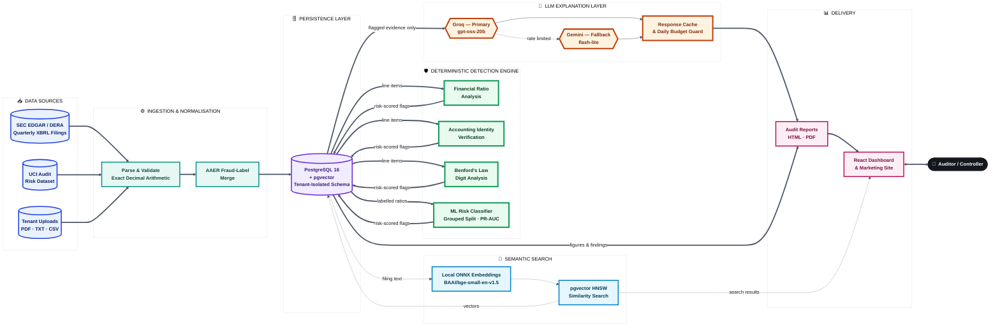

# AI Financial Reporting & Audit Intelligence Platform

[](https://github.com/codearchitect14/financial-audit-intelligence/actions/workflows/ci.yml)


A production-grade platform that screens financial statements for anomalies using
statistics and machine learning, retrieves supporting evidence with local semantic
search, and calls a large language model only in the final step — to explain
findings a deterministic engine already produced, in plain language.

---

## Table of Contents

- [Project Overview](#project-overview)
- [Objectives](#objectives)
- [What We Built](#what-we-built)
- [How It Helps](#how-it-helps)
- [Solution Architecture](#solution-architecture)
- [Technology Stack](#technology-stack)
- [Quick Start](#quick-start)
- [Running the Checks](#running-the-checks)
- [Loading Data](#loading-data)
- [Environment Variables](#environment-variables)
- [Repository Layout](#repository-layout)
- [Documentation](#documentation)
- [Project Status](#project-status)

---

## Project Overview

Financial statement review is still, in most firms, a manual process: an analyst
reads pages of filings, recomputes ratios by hand, cross-checks figures against
accounting identities, and writes up findings in prose. It is slow, inconsistent
across reviewers, and offers no way to prove a finding is reproducible.

**Ledgerline** automates the mechanical parts of that review without automating
away the judgment. Deterministic statistical and machine-learning checks decide
*what* is worth a human's attention; a language model is invoked only afterward,
and only to describe findings that already exist — never to decide whether
something is wrong. The result is a platform where every flag can be re-run,
re-verified, and defended in a review meeting on its own evidence, and where the
cost of AI usage scales with the number of *findings*, not the size of the
dataset.

The platform runs end-to-end on free-tier infrastructure: PostgreSQL with
pgvector for storage and vector search, a locally-hosted ONNX embedding model for
semantic retrieval, and Groq with a Gemini fallback for the narrative layer —
architected from the outset to be inexpensive to run and reproducible to audit.

---

## Objectives

| # | Objective | Outcome |
|---|---|---|
| 1 | Ingest and normalise real financial statement data at scale | SEC DERA quarterly filings, UCI audit risk data, and AAER fraud labels merged into one exact-decimal schema |
| 2 | Detect anomalies without relying on a language model | Ratio screens, accounting-identity checks, Benford's Law, and a grouped-split ML classifier — zero LLM calls in the detection path |
| 3 | Make findings reproducible and explainable | Every detector is a pure function; every flag carries the evidence that produced it |
| 4 | Retrieve supporting filing text instantly and for free | Local ONNX embeddings + pgvector HNSW index — no API call, no per-query cost |
| 5 | Use AI narrative generation sparingly and safely | Batched, cached, budget-guarded calls; fenced untrusted input; graceful degradation with zero keys configured |
| 6 | Enforce strict multi-tenant data isolation | Tenant scoping lives in one repository layer, never in individual handlers |
| 7 | Ship a professional, accessible, production-ready interface | A public marketing site and an authenticated dashboard, from one codebase |
| 8 | Prove correctness, not just claim it | 341 backend tests, 67 frontend tests, 16 end-to-end journeys, all enforced in CI |

---

## What We Built

- **A nine-table relational schema** in PostgreSQL, with exact `Numeric` arithmetic
  for every reported figure, tenant isolation baked into the data-access layer, and
  a fully reversible, drift-checked Alembic migration history.
- **A re-runnable ingestion pipeline** for SEC DERA quarterly XBRL archives, the
  UCI audit-risk dataset, and SEC AAER fraud-enforcement labels — idempotent by
  design, so a partial or repeated run always converges to the same state.
- **A deterministic detection engine**: standard financial ratios, an accounting
  identity check (assets = liabilities + equity, to the cent), a Benford's Law
  digit-distribution test run over defensible cohorts, and a grouped-split,
  imbalance-aware machine-learning classifier reporting PR-AUC rather than a
  misleading accuracy figure.
- **A local semantic search layer** — `BAAI/bge-small-en-v1.5` served through
  ONNX Runtime (not PyTorch, to fit inside free-tier memory limits), indexed with
  a pgvector HNSW index — that answers a query with zero LLM cost.
- **A metered, cached, fail-over LLM layer** — Groq primary, Gemini fallback,
  responses cached by prompt hash, a daily call budget enforced before dispatch,
  and every provider attempt logged for observability.
- **A complete audit-report pipeline**: every figure in a generated report comes
  from stored, computed data; the model contributes narrative only, and a report
  generated with zero LLM keys configured is still complete and correct.
- **A full-stack web application**: a professional marketing site (hero, trust
  signals, feature grid, security section) and an authenticated dashboard
  (statements, findings, search, documents, reports, settings), built with React,
  TypeScript, and Tailwind, and verified accessible.
- **Enterprise authentication and authorization**: Argon2id password hashing,
  short-lived access tokens, revocable single-use refresh sessions, and an
  ordered role hierarchy enforced identically on the server regardless of what
  the interface shows.
- **A CI pipeline** that lints, type-checks (strict, both languages), tests, audits
  dependencies, scans for committed secrets, and verifies the database migration
  is both correct and reversible — on every push.

---

## How It Helps

| For | Benefit |
|---|---|
| **Auditors & Reviewers** | A pre-screened, risk-ranked queue of statements with cited evidence on every flag, instead of scanning every filing by hand |
| **Financial Controllers** | Ratio and accounting-identity checks that catch tagging errors and inconsistencies before they reach a reviewer |
| **Compliance Teams** | A complete, append-only audit trail of every action, and findings that are reproducible on demand — not a black box |
| **Engineering / Ops** | A platform that runs, end-to-end, on free-tier infrastructure, with a bounded and predictable AI cost |
| **Leadership** | Confidence that AI is used where it adds value — explaining findings — and nowhere it would introduce risk — deciding them |

---

## Solution Architecture

The platform's single governing rule is the **order of operations**: every stage
up to and including risk scoring and retrieval is deterministic and touches no
language model. The LLM is invoked once, last, over a small and already-filtered
set of evidence.

```
Ingest → Normalise → Detect (statistics + ML) → Retrieve (pgvector) → Explain (LLM)
 no LLM     no LLM         no LLM                     no LLM          batched, cached
```

### End-to-End Flow



### Legend

| Colour | Stage | LLM involved? |
|---|---|---|
| 🔵 Blue | Data sources | No |
| 🟢 Teal | Ingestion & normalisation | No |
| 🟣 Purple | PostgreSQL + pgvector persistence | No |
| 🟩 Green | Deterministic detection engine | **No — statistics and ML only** |
| 🔷 Sky | Semantic search (local embeddings) | No |
| 🟠 Amber | LLM explanation layer | **Yes — batched, cached, budget-guarded** |
| 🌸 Pink | Delivery (reports, dashboard) | No |

Solid bold arrows (`==>`) trace the primary, always-executed path. Dashed arrows
(`-.->`) trace optional or auxiliary paths — semantic search and provider
fail-over — that do not block the primary flow.

### Why This Ordering Matters

1. **Reproducibility.** Re-running the detectors on unchanged data yields
   identical flags every time — a hard requirement for anything audit-facing that
   a sampled model cannot provide on its own.
2. **Bounded cost.** Token spend scales with the number of *findings*, not the
   size of the dataset. A 500 MB filing corpus costs the same in LLM tokens as a
   50 MB one, because only flagged evidence — never raw data — ever reaches the
   model.
3. **Graceful degradation.** With zero LLM API keys configured, ingestion,
   detection, scoring, search, and report generation all continue to work in
   full. Only the generated narrative text is absent.

---

## Technology Stack

| Layer | Technology | Notes |
|---|---|---|
| API | FastAPI on Python 3.12 | Fully async request path |
| Database | PostgreSQL 16 + pgvector | One database for relational and vector data |
| Migrations | Alembic | Synchronous engine, reversibility verified in CI |
| Embeddings | `BAAI/bge-small-en-v1.5` via `fastembed` | ONNX Runtime, 384 dimensions, ~1/10th the footprint of a PyTorch equivalent |
| Detection | scikit-learn, pandas, numpy | No LLM involvement anywhere in this path |
| LLM | Groq (`openai/gpt-oss-20b`), Gemini fallback | Cached by prompt hash, metered against a daily budget |
| Frontend | React 18, Vite, TypeScript, Tailwind CSS 4 | Marketing site plus authenticated dashboard, one bundle |
| Auth | Argon2id, JWT access tokens, revocable refresh sessions | Ordered role hierarchy enforced server-side |
| CI/CD | GitHub Actions | Lint, type-check, test, dependency audit, secret scan, migration verification |

---

## Quick Start

Requirements: Docker, Python 3.12, and [uv](https://docs.astral.sh/uv/).

```bash
# 1. Start Postgres with pgvector
docker compose -f infra/docker-compose.yml up -d db

# 2. Configure the backend
cd backend
cp .env.example .env

# 3. Install dependencies and apply the schema
uv sync --extra dev
uv run alembic upgrade head

# 4. Run the API
uv run uvicorn fai.main:app --reload
```

In a second terminal:

```bash
cd frontend
cp .env.example .env
npm install
npm run dev
```

Then:

- Application: <http://localhost:5173>
- API docs: <http://localhost:8000/docs>
- Liveness: <http://localhost:8000/api/v1/health>
- Readiness: <http://localhost:8000/api/v1/health/ready>

Readiness reports on the database and the pgvector extension individually, so a
`degraded` response tells you which dependency is missing.

> **Port note.** The stack binds Postgres to host port **5436**, not 5432, because
> 5432 is commonly already in use. Change `POSTGRES_PORT` in `infra/.env` and the
> matching `DATABASE_URL` in `backend/.env` if you want a different port.

---

## Running the Checks

```bash
cd backend
uv run ruff check .          # lint
uv run ruff format --check . # formatting
uv run mypy src              # types (strict)
uv run pytest                # tests
uv run alembic check         # models and migrations agree
```

`pytest` runs without a database: tests that need one are marked `integration` and
skip themselves when none is reachable. Start the database to run the full suite.

```bash
cd frontend
npm run lint        # ESLint, including accessibility rules
npm run typecheck   # TypeScript
npm run test        # Vitest
npm run build       # production build
npm run e2e         # Playwright, needs the API running
```

The Playwright journey needs the API started with `RATE_LIMIT_ENABLED=false`;
see [docs/frontend.md](docs/frontend.md).

---

## Loading Data

The application starts with an empty database. Ingestion, scoring, and indexing
are batch jobs, not something the web service does.

```bash
cd backend

# 1. Ingest a quarter of SEC filings. Set SEC_USER_AGENT to a real contact
#    address first: the SEC refuses requests without one.
uv run python ../scripts/ingest.py 2023q1

# 2. Run the detectors and write flags. No LLM is involved.
uv run python ../scripts/analyze.py --benford

# 3. Embed uploaded documents for semantic search.
uv run python ../scripts/index_documents.py
```

---

## Environment Variables

Every variable is documented in [`backend/.env.example`](backend/.env.example). The
ones that matter most:

| Variable | Purpose |
|---|---|
| `DATABASE_URL` | One DSN. The asyncpg and psycopg variants are derived from it, so the app and its migrations can never target different databases. |
| `JWT_SECRET_KEY` | Token signing key. The app **refuses to start in production** while this is the development default. |
| `CORS_ORIGINS` | Explicit origin allowlist. A wildcard is rejected in production. |
| `EMBEDDING_DIMENSIONS` | Must match the `vector(N)` column width. Changing it requires a migration and a full re-embed. |
| `SEC_USER_AGENT` | **Required before ingestion.** The SEC blocks requests that do not identify the client with a real contact address. |
| `GROQ_API_KEY`, `GEMINI_API_KEY` | Optional. Without them the LLM layer serves cached results only. |

---

## Repository Layout

```
backend/
  src/fai/
    core/        configuration, logging, error types
    db/          SQLAlchemy models, session management
    api/         FastAPI routers
  alembic/       migrations
  tests/         pytest suite
frontend/        React application (marketing site + dashboard)
infra/           docker-compose, Dockerfiles, database init, deploy configs
docs/            one document per subsystem
scripts/         data ingestion and batch jobs
```

---

## Documentation

| Document | Covers |
|---|---|
| [docs/architecture.md](docs/architecture.md) | System design and the no-LLM-first rule |
| [docs/data-model.md](docs/data-model.md) | Schema, tenancy rules, and why each decision was made |
| [docs/data-pipeline.md](docs/data-pipeline.md) | Datasets, ingestion, and the fraud-label merge |
| [docs/llm-strategy.md](docs/llm-strategy.md) | Token minimisation, caching, provider failover |
| [docs/frontend.md](docs/frontend.md) | React application, accessibility, build gotchas |
| [docs/security.md](docs/security.md) | OWASP review, data handling, known gaps |
| [docs/deployment.md](docs/deployment.md) | Neon, Render, Vercel runbook and rollback |
| [docs/development.md](docs/development.md) | Local setup, conventions, troubleshooting |
| [CONTRIBUTING.md](CONTRIBUTING.md) | Branching, commits, review expectations |

Interactive API documentation is generated by FastAPI at `/docs` and is disabled in
production.

---

## Project Status

| Phase | Scope | Status |
|---|---|---|
| 0 | Project setup, schema, CI, containerisation | **Complete** |
| 1 | Data pipeline (SEC DERA, UCI, AAER merge) | **Complete** |
| 2 | Core backend APIs and authentication | **Complete** |
| 3 | Anomaly detection engine | **Complete** |
| 4 | Embeddings and semantic search | **Complete** |
| 5 | LLM integration layer | **Complete** |
| 6 | Risk scoring and report generation | **Complete** |
| 7 | Frontend (marketing site and dashboard) | **Complete** |
| 8 | Security hardening and test coverage | **Complete** |
| 9 | Deployment | **Configs and runbook complete; the deploy itself requires your accounts** |

### Test Coverage

| Suite | Count |
|---|---|
| Backend (pytest) | 341 |
| Frontend (Vitest) | 67 |
| End to end (Playwright) | 16 |

### What Phase 9 Does and Does Not Include

`infra/deploy/` contains a Render blueprint, a Vercel config, and a Netlify
config, and [docs/deployment.md](docs/deployment.md) is a step-by-step runbook
with a post-deployment checklist and a rollback procedure.

The deployment itself is not done, and cannot be done from this repository: it
needs Neon, Render, and Vercel accounts, and secrets that must never be
committed. Follow the runbook with your own credentials.

### Known Gaps

Documented honestly in [docs/security.md](docs/security.md#4-known-gaps). The
ones most likely to matter: no per-organization model quota, no virus scanning
on uploads, rate limit state is in-process so it does not survive scaling out,
and PDF text extraction is not implemented (PDFs upload and store, but index as
zero chunks).
